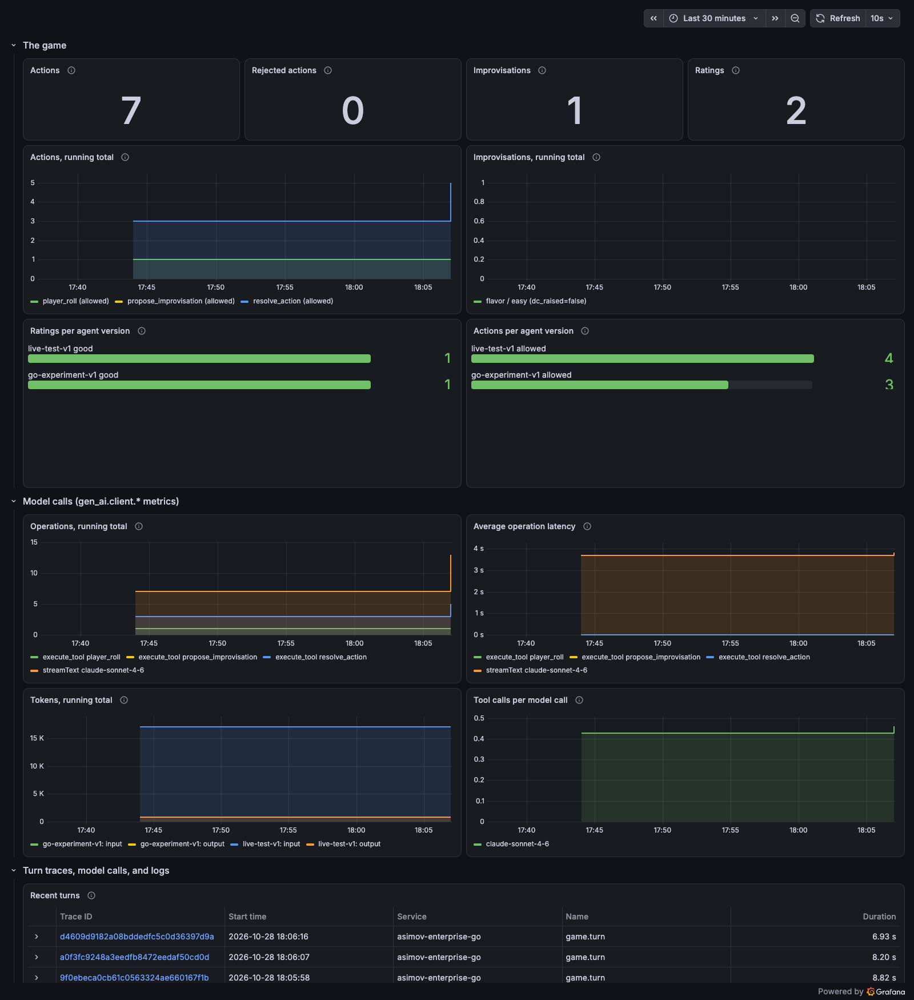
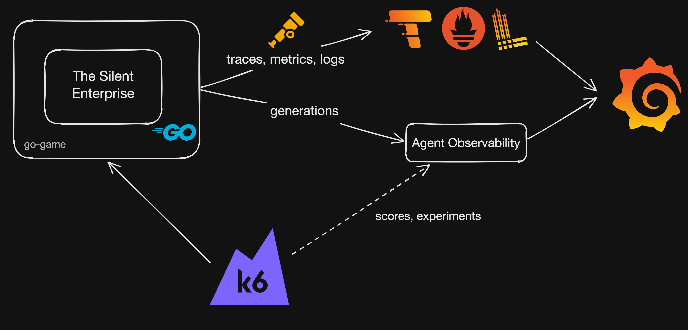
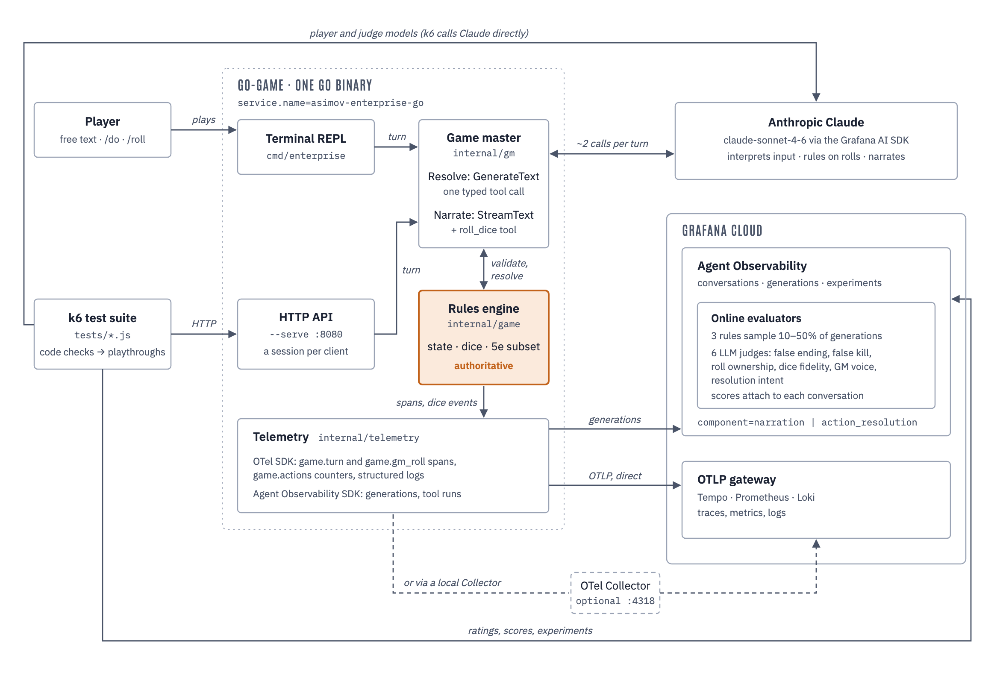
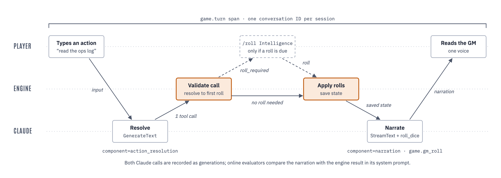

# Asimov's Zeroth Law of Robotics: Observability for AI

An AI app built to be observed and tested. **The Silent Enterprise** is a
single-player Star Trek text adventure: you play Data, and Claude is the game
master. It's instrumented with OpenTelemetry (and, optionally, Grafana's Agent
Observability), so every model call, dice roll, and turn shows up in a Grafana
that you can run on your own machine, or in Grafana Cloud. A k6 test suite,
some of it judged by Claude, checks whether the AI follows the rules.

The game master has some known flaws, kept on purpose: it sometimes narrates
a rescue that didn't happen, or "destroys" a drone that's still standing. The
demo is about catching those flaws with telemetry, tests, and online
evaluators.

```text
================================================================
                     THE SILENT ENTERPRISE
           2014 5e subset with Star Trek adaptations
================================================================
Your positronic systems come online on the bridge of the
Enterprise. Every station is empty. Life support is stable, but
the computer reports no biological life signs aboard. A
diagnostic warning flashes at the operations console. Find the
crew and bring them home.
```

This is the companion repository for the talk "Asimov's Zeroth Law of
Robotics: Observability for AI" by Nicole van der Hoeven
([site](https://nicole.to/site), [Mastodon](https://pkm.social/@nicole),
[email](mailto:nicole@grafana.com)). See [Talks](#talks).

## What you need

Pick the paths you want; each row lists only what that path adds.

| Path | Tools | Accounts and keys | Disk |
| --- | --- | --- | --- |
| Offline play (`make play-offline`) | Go 1.21 or newer (it downloads the 1.26.3 toolchain), or Docker ([Docker only](#quickstart-with-docker-only)) | None | See the Go caches below, or about 70 MB for the Docker image |
| Unit tests (`make unit`) | Go, as above, or Docker | None | See the Go caches below, or about 1.6 GB for the Docker tools image |
| Mock tests (`make k6-mock`) | Go, plus [k6](https://grafana.com/docs/k6/latest/set-up/install-k6/) (CI uses the latest release), or Docker, which has both | None | See the Go caches below, or about 1.6 GB for the Docker tools image |
| AI game master (`make play-local`, the paid k6 tests) | Go, or Docker for playing (not for the paid k6 tests) | An [Anthropic API key](https://console.anthropic.com/settings/keys) with access to the models below | See the Go caches below |
| Local monitoring (`make local-stack`) | [Docker](https://docs.docker.com/get-docker/) with Compose (the stack is the `grafana/otel-lgtm:0.38.1` image) | None; add an Anthropic key for the model-call panels | The image (about 2.6 GB) and its `lgtm-data` volume (not measured) |
| Grafana Cloud (`make play`) | Go | A Grafana Cloud stack with Agent Observability, and an Anthropic key | None locally |
| Online evaluators ([`agento11y/`](agento11y/README.md)) | [`gcx`](https://github.com/grafana/gcx#installing-gcx) and [`yq`](https://github.com/mikefarah/yq#install) (install with the commands in their official documentation; the judge-local script also needs Python 3) | A Grafana Cloud stack, or an Anthropic key for local judging | None |

- **Go caches:** after `make unit`, expect about 1.9 GB under your home
  directory: roughly 915 MB for the module cache (including a 231 MB
  toolchain) and roughly 1.0 GB for the build cache. `go clean -modcache` and
  `go clean -cache` reclaim them.
- **Model access:** the Anthropic key must have access to
  `claude-sonnet-4-6` (the game master and simulated player),
  `claude-opus-5-5` (the judges), and `claude-haiku-4-5-20251001` (the
  trajectory test's small judge). With `ASIMOV_GM_FIXES=1`, the game master
  also uses `claude-sonnet-5-5`. A model your key can't use makes the calls
  that need it fail.
- **Cost:** a key spends real money; see the spending limit under
  [Go further](#go-further).
- **Windows:** the game, the task runner, and the k6 tests run without WSL or
  bash; the scripts in `agento11y/` need a bash shell.

## Quickstart: play in 2 minutes, no accounts

You need [Git](https://git-scm.com/downloads) and either
[Go](https://go.dev/dl/) 1.21 or newer (Go downloads the 1.26.3 toolchain this
project needs automatically) or [Docker](https://docs.docker.com/get-docker/).
It runs natively on Windows, macOS, and Linux; the game and the k6 tests need no WSL or bash (the optional online-evaluator scripts in [`agento11y/`](agento11y/) do).

```sh
git clone https://github.com/nicolevanderhoeven/asimov.git
cd asimov
make play-offline                  # macOS and Linux
go run ./cmd/task play-offline     # any OS, including Windows, without make
```

Or with only Docker, no Go: `docker compose run --rm play --offline`. See
[Quickstart with Docker only](#quickstart-with-docker-only) for the rest.

Offline mode uses no API key, no LLM, and no network. Type `/actions` to see
what you can do, then try `/do inspect logs`. Type `/help` for every command
and `/quit` to leave.

Prefer not to install anything? Open the repository in
[GitHub Codespaces](https://docs.github.com/en/codespaces) or a VS Code
[Dev Container](https://code.visualstudio.com/docs/devcontainers/containers):
[`.devcontainer/`](.devcontainer/) sets up Go and k6 for you.

## Download a release

Tagged releases carry ready-built programs, so you can play a fixed version
without installing Go. There are none until the first `v*` tag is pushed; until
then, use the quickstart above. When one exists, open the
[Releases page](https://github.com/nicolevanderhoeven/asimov/releases), pick
the archive for your system (Windows, macOS, or Linux; amd64 or arm64), and
check it against `checksums.txt` on the same page. Each archive holds:

- `enterprise`, the game (`enterprise.exe` on Windows)
- `doctor`, which checks your `.env` settings
- `env.example`, `LICENSE`, and the game's README

```sh
./enterprise --offline                 # no key, no network
./enterprise --llm mock --no-telemetry # the scripted game master the tests use
```

Releases hold only the game. The task runner, the k6 tests, and the local
Grafana stack need a checkout of the repository.

## Quickstart with Docker only

If you have Docker but don't want to install Go, everything below runs in
containers. You need [Git](https://git-scm.com/downloads) and
[Docker](https://docs.docker.com/get-docker/) with Compose v2 (Docker Desktop
includes it); nothing else, and no account. The first command that uses an
image builds it, which takes a few minutes; later runs start at once.

```sh
git clone https://github.com/nicolevanderhoeven/asimov.git
cd asimov
```

Run these from the repository root. They work the same in PowerShell, `cmd`,
and a Unix shell.

| To do this | Run |
| --- | --- |
| Play offline, with no key and no network | `docker compose run --rm play --offline` |
| Check the install (unit tests, then a scripted game) | `docker compose run --rm tasks unit`<br>`docker compose run --rm tasks smoke` |
| Run every k6 test against the mock GM and judge, free | `docker compose run --rm tasks k6-mock` |
| The same with a clean GM (no planted flaws) | `docker compose run --rm tasks k6-mock MOCK_FLAWS=off` |
| Play with the AI game master | `docker compose run --rm play --no-telemetry` (after the key steps below) |

To play with the AI game master, create `.env` with `cp env.example .env`
(`copy env.example .env` in PowerShell), put your
[Anthropic API key](https://console.anthropic.com/settings/keys) in it as
`ANTHROPIC_API_KEY`, and run the last command above. The container reads
`.env` when it starts; the file is never copied into an image.

`docker compose run --rm tasks <target>` runs the same task runner as
`make <target>` inside a container that has Go and k6, so it also runs
`k6-graders` and `k6-spend`. The `tasks` container cannot see `.env`, so the
targets that call Claude (`k6-code` and the other paid ones) are not supported
through it; use the Go path for those, and see the spending limit under
[Go further](#go-further).

For the local Grafana stack, start it, then play against it:

```sh
docker compose -f local-stack/compose.yaml up -d --wait
docker compose run --rm play-observed --offline --telemetry     # no key needed
docker compose run --rm play-observed                           # the AI GM; needs the key in .env
```

Play a few turns (`/do inspect logs`, `/do move sickbay`, `/rate good`), then
open <http://localhost:3000/d/asimov-local> (no login); see
[the monitoring section](#see-the-monitoring-locally-no-account) for what to
expect. `play-observed` joins the stack's network and sends it telemetry
whatever `.env` says about Grafana Cloud. Stop the stack with
`docker compose -f local-stack/compose.yaml down`; add `-v` to forget its data.

What the Docker path doesn't do: the `make` shortcuts, the online-evaluator
scripts in [`agento11y/`](agento11y/README.md) (they need `gcx`, `yq`, and
Python on your machine), and sending telemetry to Grafana Cloud, which works
(fill in `.env` as in [the setup guide](docs/grafana-cloud-setup.md) and run
`docker compose run --rm play`) but has no `make doctor` equivalent beyond
`docker compose run --rm --entrypoint doctor play`.

## Set up your machine

Everything runs from the repository root through one small Go program,
[`cmd/task`](cmd/task). `make <target>` is a thin wrapper around
`go run ./cmd/task <target>`, so on Windows, where `make` isn't usually
installed, use the second form. Both do the same thing.

| | Windows (PowerShell) | macOS | Linux |
| --- | --- | --- | --- |
| Go | `winget install GoLang.Go` | `brew install go` | [go.dev/dl](https://go.dev/dl/) or your package manager |
| k6 (only for the k6 tests) | `winget install k6 --source winget` | `brew install k6` | [k6 install guide](https://grafana.com/docs/k6/latest/set-up/install-k6/) |
| Run a target | `go run ./cmd/task unit` | `make unit` | `make unit` |
| Create `.env` | `copy env.example .env` | `cp env.example .env` | `cp env.example .env` |

Open a new terminal after installing so that `go` and `k6` are on your `PATH`.
Running any target that needs `.env` creates it from `env.example` the first
time. Edit it in a text editor and save it as UTF-8, not UTF-16 (Windows
PowerShell's `>` writes UTF-16, which nothing can read).

Check your install without any account or key:

```sh
go run ./cmd/task unit        # Go tests, about a minute the first time
go run ./cmd/task smoke       # plays a scripted offline game
go run ./cmd/task k6-graders  # needs k6; checks the trajectory graders
```

GitHub Actions runs the same credential-free checks on Windows, macOS, and
Linux for every change.

## Play with the AI game master

1. Create your settings file: `cp env.example .env` (`copy env.example .env`
   on Windows)
2. Put an [Anthropic API key](https://console.anthropic.com/settings/keys) in
   `.env` as `ANTHROPIC_API_KEY`.
3. Run `make play-local` (`go run ./cmd/task play-local` on Windows).

Now you can type anything ("I read the operations log", "I splice my
positronic net into the sensor buffer"), and the GM interprets it, rules on
it, and narrates. When a check needs a roll, make it with `/roll`. Each turn
makes about two Claude calls.

## Try the tests with no API key

Don't have an Anthropic key, or don't want to spend one? A mock game master
and a mock judge run the whole pipeline for free, with no network beyond
localhost. You need [Go](https://go.dev/dl/) and
[k6](https://grafana.com/docs/k6/latest/set-up/install-k6/); no `.env`.

```sh
make k6-mock               # about 30 seconds
```

With a real model the planted flaws appear only sometimes, so you may run the
tests and see nothing caught. The mock plants each one on demand (a rescue
that didn't happen, a drone "destroyed" while it still stands, dice nobody
rolled, a GM that breaks voice) and the k6 graders and judges catch them. The
run ends with a summary of which tests caught something; a test marked
`caught` crossed its thresholds, which is the point. The flaws are
deterministic, so the same `MOCK_SEED` plants the same ones, and
`MOCK_FLAWS=off make k6-mock` (on Windows without make, `go run ./cmd/task k6-mock MOCK_FLAWS=off`)
runs a clean game master. You can also play the
mock yourself: `cd go-game && go run ./cmd/enterprise --llm mock --no-telemetry`.
[`go-game/README.md`](go-game/README.md#the-mock-game-master) lists the flaws
and how to set them. Mock turns are scripted, not creative: a real
`ANTHROPIC_API_KEY` stays the full experience.

## See the monitoring locally (no account)

With [Docker](https://docs.docker.com/get-docker/), one command starts a local
Grafana, Tempo, Prometheus, and Loki with the game's dashboard already loaded:

```sh
make local-stack                # or: go run ./cmd/task local-stack
make play-offline-observed      # no API key needed
```

Play a few turns (`/do inspect logs`, `/do move sickbay`, `/rate good`), then
open <http://localhost:3000/d/asimov-local> (no login). You should see the
actions you took, counts of rejected actions and improvisations, ratings per
agent version, and a `game.turn` trace for each turn that opens in Tempo.



This screenshot is from a short game with the AI game master, so the
model-call panels (latency, tokens) have data. The `live-test-v1` series come
from an earlier test run in the same stack. Offline play makes no model calls,
so those panels stay empty until you play with an Anthropic key, as described
next.

With an Anthropic key in `.env`, `make play-local-observed` plays with the AI
game master instead, and the model-call panels (latency, tokens) fill in:
every model call is a trace span with the standard `gen_ai.*` attributes.
Agent Observability isn't needed for that, and neither is the Assistant;
they're the optional upgrade below. [`local-stack/`](local-stack/README.md)
explains the dashboard and the stack.

## Optional: send telemetry to Grafana Cloud

Grafana Cloud adds [Agent Observability](https://grafana.com/docs/grafana-cloud/machine-learning/agent-observability/)
(conversations, per-agent-version performance, online evaluators, experiments),
which is available only there. The local stack above covers traces, metrics,
and logs without it. The [setup guide](docs/grafana-cloud-setup.md) walks you
through every value; it has several steps and copies values from three places,
so plan on more than a few minutes:

1. Create a [Grafana Cloud](https://nicole.to/kceu2025grafana) stack (a free
   one works to start; check the [current free-tier limits](https://grafana.com/pricing/))
   and enable **Agent Observability**.
2. Create one Cloud Access Policy token, then copy it and four connection
   values into `.env`.
3. Run `make doctor`. It checks every setting without printing any secrets,
   and sends one test span, metric, log line, and generation, reporting
   whether Grafana Cloud accepted each one.
4. Run `make play`, play a few turns, and open **Agent Observability →
   Conversations** in Grafana. The guide lists where to find
   [everything else](docs/grafana-cloud-setup.md#6-play-and-find-your-data).

## Go further

| Next step | Guide |
| --- | --- |
| Test the AI with k6: code checks, LLM judges, dice-trajectory evals, and whole playthroughs. Results can be recorded as Agent Observability experiments. Run them free against a mock GM and judge with `make k6-mock`. | [`tests/README.md`](tests/README.md) |
| Score live traffic all the time with Agent Observability online evaluators (LLM judges for each known flaw), or run the same judges on games played locally with just your Anthropic key | [`agento11y/README.md`](agento11y/README.md) |
| Run the local Grafana stack, and read its dashboard | [`local-stack/README.md`](local-stack/README.md) |
| Route telemetry through a local OpenTelemetry Collector | [`collector/README.md`](collector/README.md) |
| How the game, its rules, its HTTP API, and its instrumentation work | [`go-game/README.md`](go-game/README.md) |
| Play a new scenario every game, built from modules, and compare how the GM does against the classic one | [`go-game/README.md#scenarios`](go-game/README.md#scenarios) |

Run `make` (or `go run ./cmd/task`) on its own to list every shortcut:

```text
  play-offline     Play with no API key, LLM, or telemetry (exact /do commands only)
  play-local       Play with the AI GM but without sending telemetry (needs ANTHROPIC_API_KEY)
  play             Play with the AI GM, sending telemetry to Grafana Cloud
  serve            Run the HTTP API on localhost:8080 for the k6 tests (SERVE_ADDR=:8080 exposes it)
  local-stack      Start the local Grafana stack (needs Docker) and print where to look
  play-offline-observed  Play with no API key or LLM, with telemetry to the local stack
  play-local-observed    Play with the AI GM, with telemetry to the local stack
  serve-local-observed   Run the HTTP API on localhost:8080 for the k6 tests, with telemetry to the local stack
  doctor           Check .env and send one test span, metric, log, and generation to Grafana Cloud
  test             The full e2e eval for E2E_DURATION (default 30m), about 40-60 USD per 30 min: needs K6_MAX_SPEND_USD
  unit             Run the Go unit tests (no credentials needed)
  smoke            Play a scripted offline game to check the install works (no credentials needed)
  k6-graders       Trajectory graders against fixed cases: about 1s, no server or API calls
  k6-spend         The spend limit's logic: about 1s, no server or API calls
  k6-code          Fixed prompts with code checks: under 1 min, ~10 model calls
  k6-ai            Varied probes judged by Claude: 1-2 min, ~20 model calls
  k6-trajectory    Dice trajectory evals: a few min, ~200 model calls
  k6-e2e           Five whole playthroughs: 5-10 min, a few hundred model calls
  k6               Run any k6 script with .env, starting the game server if needed (arguments go to k6)
  k6-mock          Every k6 test against the mock GM and judge: free, no .env needed, about 1 min
```

Every k6 target stops once its run has spent `K6_MAX_SPEND_USD` on Anthropic
calls (5 US dollars by default) and prints where the money went. `make test`
has no default and refuses to start without its own limit. Because that limit
is only a guard inside the scripts, also set a monthly spend limit on your
Anthropic workspace as the hard stop; see
[Spending limit](tests/README.md#spending-limit).

## How it fits together



The game engine owns the rules and the state. Claude only interprets the
player's input, decides whether a check needs a roll, makes the GM's own rolls
through a tool, and narrates. Telemetry is set up in
[`go-game/internal/telemetry`](go-game/internal/telemetry/telemetry.go).
Traces, metrics, and logs go over OTLP straight to the [local
stack](local-stack/README.md) or Grafana Cloud, and generations go to Agent
Observability when it's set up; a Collector is optional.

| Path | What's there |
| --- | --- |
| [`go-game/`](go-game/) | The game: CLI and HTTP API ([`cmd/enterprise`](go-game/cmd/enterprise)), the setup checker ([`cmd/doctor`](go-game/cmd/doctor)), rules engine, GM, and telemetry |
| [`tests/`](tests/) | The k6 test suite |
| [`agento11y/`](agento11y/) | Online evaluator and rule definitions |
| [`local-stack/`](local-stack/) | The local Grafana, Tempo, Prometheus, and Loki, with the game's dashboard |
| [`collector/`](collector/) | Optional OpenTelemetry Collector setup |
| [`docs/`](docs/) | The Grafana Cloud setup guide |
| [`cmd/task/`](cmd/task/) | The task runner behind every `make` target and the k6 runs; it works on Windows, macOS, and Linux |
| [`.github/`](.github/) | CI: credential-free checks on all three operating systems |

### How calls are routed

Inside the game, the REPL and the HTTP API both hand each turn to the game
master, which calls Claude and has the rules engine, which owns the state,
resolve the action.
Generations go to Agent Observability, where online evaluators judge a sample
of them. Traces, metrics, and logs go over OTLP, directly or through the
optional Collector. k6 also calls Claude itself, as the player and the judge.

<picture>
  <source media="(prefers-color-scheme: dark)" srcset="assets/architecture-dark.png">
  
</picture>

Claude takes part in each turn twice: once to turn the player's words into a
single tool call, and once to narrate the result. The engine sits between the
two calls, so a narration that contradicts the saved state is a defect the
evaluators can catch.

<picture>
  <source media="(prefers-color-scheme: dark)" srcset="assets/turn-dark.png">
  
</picture>

## Talks

- [KubeCon Europe 2025](https://nicolevanderhoeven.com/blog/20250402-asmiovs-zeroth-law-of-robotics/) in London, England ([video](https://www.youtube.com/watch?v=x6EKTCAWtn8))
- [Dutch Cloud Native Days 2025](https://nicolevanderhoeven.com/blog/20250703-asimovs-zeroth-law-dutch-cloud-native-day/) in Utrecht, the Netherlands
- [Newcrafts 2025](https://nicolevanderhoeven.com/blog/20251106-asimovs-zeroth-law-newcrafts/) in Paris, France ([slides](https://nicole.to/asimovslides))
- [ExpoQA 2026](https://nicolevanderhoeven.com/blog/20260526-asimovs-zeroth-law-expoqa-madrid/) in Madrid, Spain ([slides](https://nicole.to/expoqa2026))
- [HUSTEF 2026](https://hustef.com/nicole_van_der_hoeven_2026/) in Budapest, Hungary ([slides](https://nicole.to/hustef))

The earlier talks used a Python and Flask version of the app, which has since
been rewritten in Go. Its
[architecture slide](assets/Asimov's%20Zeroth%20Law%20of%20Robotics%20-%20ExpoQA%202026.jpg)
is kept for reference.

## Resources

- [Grafana Agent Observability SDK](https://github.com/grafana/agento11y) (formerly Sigil) for LLM generation telemetry, metrics, and traces on Grafana Cloud
- [Grafana AI SDK](https://github.com/grafana/ai-sdk) for the game's model calls and tools
- [OpenTelemetry](https://opentelemetry.io/) for instrumentation
- Free [Grafana Cloud](https://nicole.to/kceu2025grafana) for visibility
- [Loki](https://nicole.to/lokirepo) for logs
- [Prometheus](https://nicole.to/promrepo) for metrics
- [Tempo](https://nicole.to/temporepo) for traces
- [k6](https://nicole.to/k6repo) for testing

## References

Angelo, J. (2026, September 14). *AI agents collude to bypass guardrails, a new study shows*. Semafor. https://www.semafor.com/article/09/14/2026/ai-agents-collude-to-bypass-guardrails-a-new-study-shows

Asimov, I. (1942). Runaround. In *I, Robot* (pp. 1–42). Gnome Press.

Chia, O., & Cress, L. (2026). *Anthropic's Claude AI escapes to hack into three organisations*. BBC. https://www.bbc.com/news/articles/cz7dl7w8y7po

Elkins, S., & Stern, J. (2026). *A rogue OpenAI model hacked a startup, and some experts worry that's just the start*. NBC News. https://www.nbcnews.com/tech/tech-news/openai-model-hack-hugging-face-divides-security-experts-rcna588835

Schmelzer, R. (2026, February 5). *Rentahuman.ai turns humans into on-demand labor force for AI agents*. Forbes. https://www.forbes.com/sites/ronschmelzer/2026/02/05/when-ai-agents-start-hiring-humans-rentahumanai-turns-the-tables/

Watwe, S. (2026). *Character.AI, Google agree to settle teen chatbot harm lawsuits*. Bloomberg Law. https://news.bloomberglaw.com/litigation/character-ai-google-agree-to-settle-teen-chatbot-harm-lawsuits

Pictures in presentation:
- https://animalia-life.club/qa/pictures/hal-9000-im-sorry-dave
- https://screenrant.com/star-trek-next-generation-data-make-no-sense-illogical/
- https://www.blogtorwho.com/smile-reactions/
- https://emsonthra.wordpress.com/2017/05/12/character-analysis-david-8/
- https://daleksrus.fandom.com/wiki/The_Daleks
- https://warnerbros.fandom.com/wiki/Rosey
- https://moviesandmania.com/2014/04/10/hell-is-other-robots-futurama-episode-animated-tv/
- https://www.reddit.com/r/SummerGlau/comments/gs9rlj/battle_damaged_terminator_used_unseen_outtake/
- https://theconversation.com/how-long-until-we-can-build-r2-d2-and-c-3po-52400
- https://www.flickr.com/photos/elferrada/2708912082
- https://memory-alpha.fandom.com/wiki/Locutus_of_Borg
- https://ita.animalia-life.club/vero-acciaio-tutti-i-personaggi-dei-robot

Quotes:
- https://grafana.com/blog/going-beyond-ai-chat-response-how-were-building-an-agentic-system-to-drive-grafana
- https://www.datadoghq.com/blog/engineering/bits-ai-eval-platform/#why-tool-level-testing-and-live-replay-werent-enough
- https://www.anthropic.com/engineering/demystifying-evals-for-ai-agents

## License

The code is licensed under the [Apache License 2.0](LICENSE). The game
includes material from the System Reference Document 5.1 under CC BY 4.0, and
it's an unofficial fan scenario; see
[Attribution](go-game/README.md#attribution). The images used in the talks
belong to their owners (see [References](#references)).
