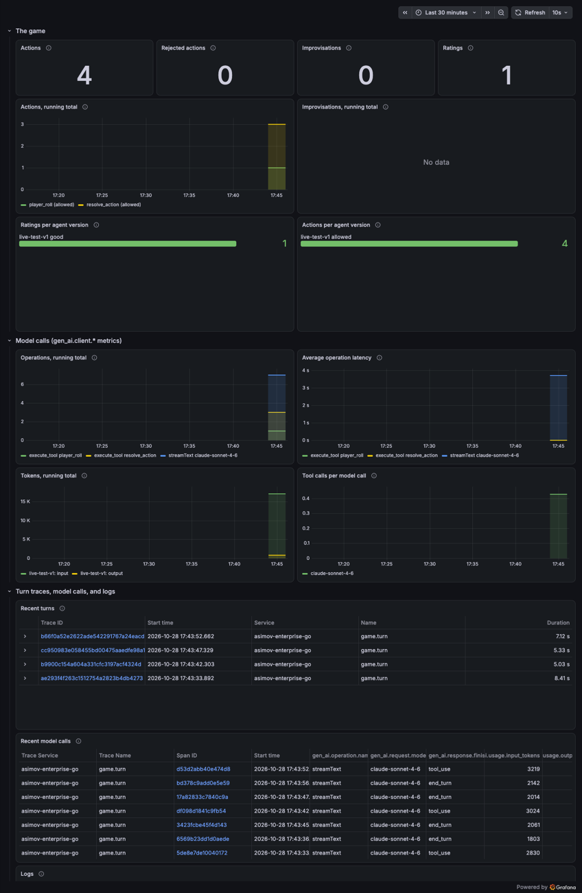

# See the game's monitoring locally, with no account

This directory runs Grafana's all-in-one
[`grafana/otel-lgtm`](https://github.com/grafana/docker-otel-lgtm) image
(Grafana, Tempo, Prometheus, and Loki, with an OpenTelemetry Collector in
front) under Docker Compose. The game sends its traces, metrics, and logs
over OTLP to `localhost:4318`, and Grafana opens with the asimov dashboard
already loaded. It needs [Docker](https://docs.docker.com/get-docker/) and
nothing from Grafana Cloud.

```sh
make local-stack              # or: go run ./cmd/task local-stack
make play-offline-observed    # no API key: exact /do commands, telemetry to the stack
make play-local-observed      # the AI game master (needs ANTHROPIC_API_KEY in .env)
```

Then open <http://localhost:3000/d/asimov-local>. There's no login: Grafana
runs with anonymous admin access, which is safe only because every port is
bound to `127.0.0.1`. `make local-stack-down` stops the stack and keeps its
data in the `lgtm-data` volume; `docker compose -f local-stack/compose.yaml down -v`
forgets it.

These targets set `OTLP_ENDPOINT` and blank every Grafana Cloud setting for
the game they start, whatever `.env` says, so one `.env` can serve both the
local and the Cloud setups. The same goes for `make doctor-local`, which sends
a test span, metric, and log to the stack (its Anthropic check fails without a
key; the other checks don't need one).

## What you get




The first screenshot is from a real run of `make play-offline-observed` (four
short games under two `ASIMOV_AGENT_VERSION`s, rated good and bad), so its
model-call panels are empty. The second is from a real run of
`make play-local-observed` (four scripted turns on `claude-sonnet-4-6`, rated
good), where they fill in. The dashboard,
[`dashboards/asimov.json`](dashboards/asimov.json), has:

| Panel | Source |
| --- | --- |
| Actions, rejected actions, improvisations, ratings, and their running totals | `game_actions_total`, `game_improvisations_total`, `game_ratings_total` |
| Ratings and actions per agent version | the same counters, by `service_version` (set `ASIMOV_AGENT_VERSION` per variant, then rate games with `/rate good` or `/rate bad`) |
| Operations, latency, tokens, and tool calls per model call | the `gen_ai_client_*` metrics the Agent Observability SDK records |
| Recent turns | one `game.turn` trace per player turn, in Tempo; open one to see its dice events and model calls |
| Recent model calls | one span per model call (`gen_ai.operation.name` is `streamText`) with the standard `gen_ai.*` attributes: model, token counts, finish reason |
| Logs | the game's logs in Loki, `{service_name="asimov-enterprise-go"}` |

Grafana also has the three data sources (Prometheus, Tempo, and Loki, with
trace-to-logs links set up) provisioned by the image, so **Explore** and
**Drilldown** work as well.

## Model calls without Agent Observability

Agent Observability is a Grafana Cloud service; only its SDK is public. With
none of its settings (`AGENTO11Y_ENDPOINT`, `GRAFANA_CLOUD_INSTANCE_ID`,
`GRAFANA_CLOUD_API_KEY`), the game doesn't try to export generations: it
starts normally and says "Agent Observability is off". Each model call is
still recorded as a span with the standard gen-AI attributes
(`gen_ai.request.model`, `gen_ai.usage.input_tokens`, and so on) and as a sample
in the `gen_ai_client_*` metrics, so you can find and read every call in Tempo,
just not in the Agent Observability app (conversations, evaluator scores,
experiments). `/rate` counts ratings in `game_ratings_total` instead of
attaching them to a conversation.

Partly filling in the Agent Observability settings is still an error that
names what's missing, so a half-configured Cloud setup isn't silently ignored.

To judge the game with the evaluators, with no Cloud stack either, see
[Judging locally](../agento11y/README.md#judging-without-grafana-cloud).

## Running the k6 tests against it

The k6 targets start their own game server from `.env`. To send its telemetry
to the stack instead, start the server yourself first; the k6 targets use a
server that's already answering on `:8080`:

```sh
make serve-local-observed      # terminal 1
make k6-code                   # terminal 2
```

## Notes

- The image is pinned (`grafana/otel-lgtm:0.38.1`); update it deliberately and
  check the dashboard when you do. This is a local demo stack, not a
  production setup: no authentication, no retention settings.
- Ports: Grafana on 3000 (set `ASIMOV_GRAFANA_PORT` to move it), OTLP on 4317
  (gRPC) and 4318 (HTTP). The [Collector setup](../collector/README.md) uses
  the same OTLP ports, so run one or the other.
- The game accepts a plain-HTTP `OTLP_ENDPOINT` only on localhost, so run the
  game on the same machine as the stack (the Docker `play` service can't reach
  it).
- If Docker's disk is full, Loki can't store logs (Grafana shows "No data" in
  the Logs panel) while metrics and traces still arrive; free some space with
  `docker system df` and `docker system prune`.
